# Nova DSO Tracker

A Flask-based web application for astrophotographers — track deep-sky objects, plan imaging sessions, and log your results.

**New in 7.1:** the [Solar System](#solar-system) page — planets and the Moon, with an event calendar, a planetary imaging calculator, a seeing forecast, and detail cards for the Moon, Jupiter, Mars and Saturn.

---

## Features

* **Solar System:** Planets and the Moon for your location — rise/transit/set, altitude charts, a Calendar of oppositions, elongations and conjunctions, a planetary imaging calculator with a seeing forecast, and detail cards for the Moon, Jupiter, Mars, Saturn, Venus and Mercury.
* **Fast, Browser-Side Calculations:** The dashboard table, charts, Outlook, yearly heatmap and Imaging Opportunities are calculated in your browser in milliseconds, with the server as a fallback.
* **Ask Nova AI:** AI-powered target ranking that analyzes your object list against current sky conditions, moon phase, and equipment to recommend the best targets for tonight. Supports Anthropic, OpenAI, Ollama, and any OpenAI-compatible provider. Entirely optional — works without AI.
* **Log File Analysis:** Import and analyze session logs from ASIAIR, PHD2, and N.I.N.A. Reports include guiding performance, autofocus V-curves, exposure stats, and session swimlane timelines.
* **Multi-Language Support:** Available in English, German, French, Spanish, Japanese, and Chinese Simplified. Language selector in the header with persistent preference per user.
* **Mobile Companion:** Full planning on the go — object detail, altitude charts, filtering, outlook, journal entry creation, and framing assistant from your phone.
* **User Management (Multi-User Mode):** Web-based admin panel to create, activate/deactivate, reset passwords, and delete users — no command line required.
* **Guide Optics & Dither Recommendations:** Configure guiding equipment per rig and get dither pixel recommendations based on your guide camera pixel scale.
* **Custom Mono Filters:** Define custom mono filters in the journal with per-session tracking and full YAML export/import support.
* **Night Explorer (Inspiration Tab):** Visual gallery of targets currently observable from your location, shown 20 tiles per page and following the dashboard's current sort order.
* **Yearly Heatmap:** Waterfall visualization of target visibility over 12 months with moon period indicators.
* **Project Management & Journal:** Group imaging sessions into Projects, track integration time, rate your guiding against your rig's image scale, and generate PDF reports with embedded log charts.
* **Gallery Tab:** A showcase grid of your session and project photos, linked straight to the journal.
* **Mosaic Planning & Export:** Plan multi-pane mosaics in the Framing Assistant and export as CSV for ASIAIR or N.I.N.A.
* **Real-time Tracking:** Altitude and azimuth tracking for DSOs updated every minute.
* **Theme Preference:** Choose Light, Dark, or Follow System. Your preference persists across sessions.
* **Duplicate Management:** Scan for objects with similar coordinates and merge them into a single entry.

## Technologies Used

* **Backend:** Python (Flask, SQLAlchemy, AstroPy, Ephem)
* **Database:** SQLite (schema changes applied via hand-written, idempotent patches)
* **Frontend:** HTML5, JavaScript, Aladin Lite
* **Integrations:** SIMBAD (Object data), Stellarium (Planetarium control)
* **AI (optional):** Anthropic, OpenAI, or Ollama for Ask Nova features

---

# Nova DSO Tracker - User Guide

### Purpose

Nova helps track Deep Sky Objects (DSOs) positions throughout the night for astrophotography or visual observations. It updates positions every minute, highlights objects marked for attention, and provides graphical insights into visibility, moon illumination, and imaging windows.

### Main Interface (The Dashboard)

When opening Nova, you see a list of DSOs sorted by default by their current altitude.

* **Highlights:** Pinned objects are highlighted.
* **Altitude Color Coding:** Altitudes above your defined threshold appear in green.
* **Horizon Mask:** If a Horizon Mask is defined and an object is obstructed by terrain, the field turns yellow.
* **Observable Window:** The "Observable" column shows the minutes an object is visible between astronomical dusk and dawn.
* **Quick View:** Click the 'i' icon next to an object's name to quickly see its inspiration image and altitude graph without leaving the dashboard.
* **Live Updates:** The table is recalculated in your browser every 60 seconds, without a request to the server.
* **Tabs:** Position, Properties, Outlook, Heatmap, Inspiration, Journal and Gallery. The **Gallery** tab shows your session and project photos as a card grid; click a tile to open that session or project.

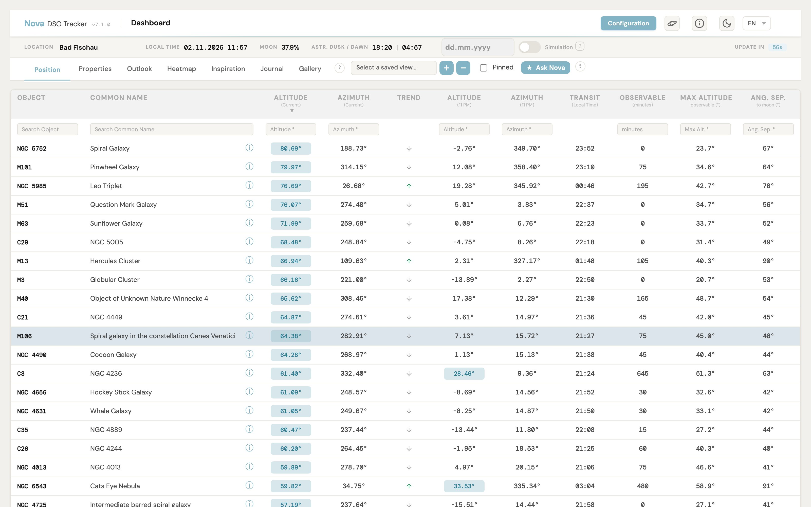
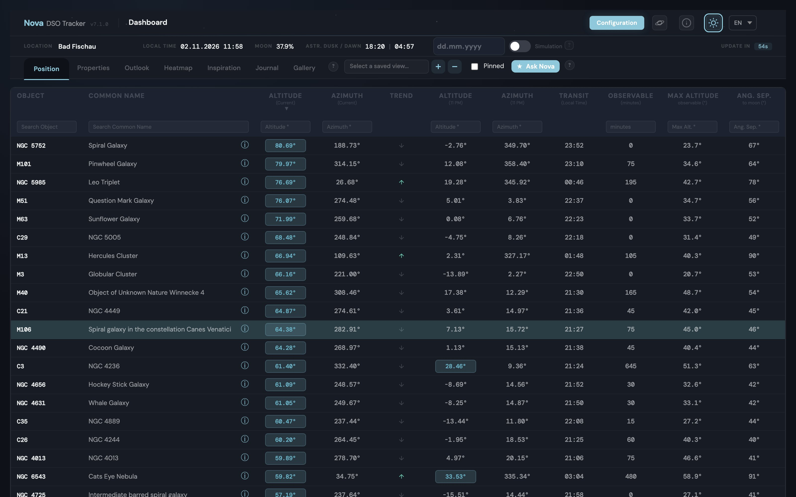

### Ask Nova AI

Ask Nova is an optional AI assistant that ranks your visible objects to recommend the best targets for tonight. It considers altitude curves, transit times, moon phase and separation, and your equipment specs.

* **Ask Nova button** on the dashboard toolbar triggers an AI ranking. Objects are re-sorted with a dedicated Nova Rank column.
* **Restore Nova** reloads a cached ranking instantly (cached per location and day). **Re-ask** forces a fresh AI query.
* **Inspiration Tab** also respects Nova rankings — when active, tiles are ordered by AI recommendation.
* **Journal AI features:** Generate observation notes for any target, or stream a full session summary (weather, conditions, equipment, targets) directly from the journal form.

Ask Nova is disabled by default. To enable it, see [AI Configuration](#ai-configuration-optional).


### Solar System

Click the planet icon in the dashboard header to open the Solar System page. Everything on it is calculated in your browser for the selected location.

* **Bodies:** Mercury to Neptune and the Moon, with current altitude and azimuth, rise, transit and set, tonight's maximum altitude, magnitude, apparent diameter, illumination and elongation. Click a body to see its altitude chart for tonight, a month or a year.
* **Calendar:** Upcoming oppositions, greatest elongations, planet–planet and Moon–planet conjunctions, Venus brilliancy and dichotomy, lunar X and V, Jupiter double shadow transits and Iapetus elongations. Hover a Mars opposition to see its date of closest approach. Filter by body or event type, or hide events that are not visible from your location.
* **Planetary Calculator:** Pick a telescope, camera and Barlow from your equipment to see the disc size in pixels, whether your focal ratio matches the camera, how much detail to expect, the rotation limit for a single video, and a sensor preview with a suggested ROI (or mosaic panel count for the Moon).
* **Seeing Forecast:** A four-night seeing outlook derived from the jet stream over your location.
* **Moon detail:** Colongitude, libration and illumination, with the craters and maria on the terminator tonight.
* **Jupiter detail:** Galilean moon positions, Great Red Spot transit time and central meridian, tonight's satellite and shadow transits, and shadow transits over the coming nights.
* **Mars detail:** Central meridian, the best time tonight, and the surface features on the disc.
* **Saturn detail:** Ring tilt and whether the rings are opening or closing, and the positions of Titan, Iapetus and the inner moons.
* **Venus and Mercury:** Phase cards showing the disc at tonight's phase and when it is worth looking.

Detail diagrams can be flipped to match a diagonal or Newtonian view.

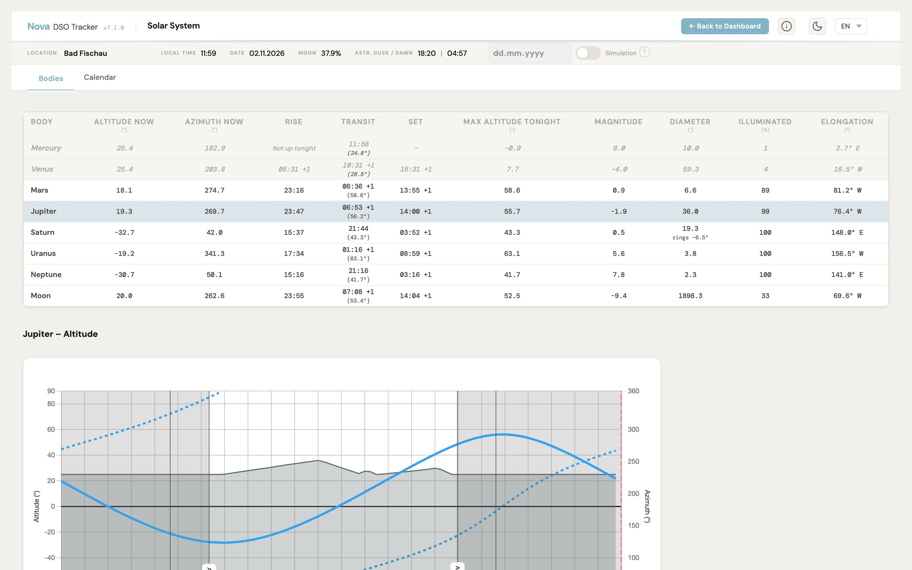
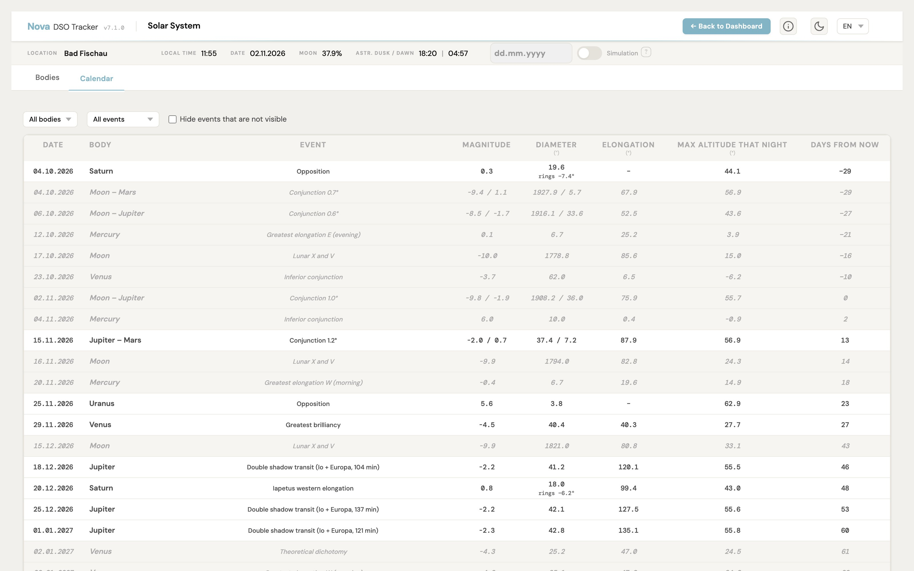
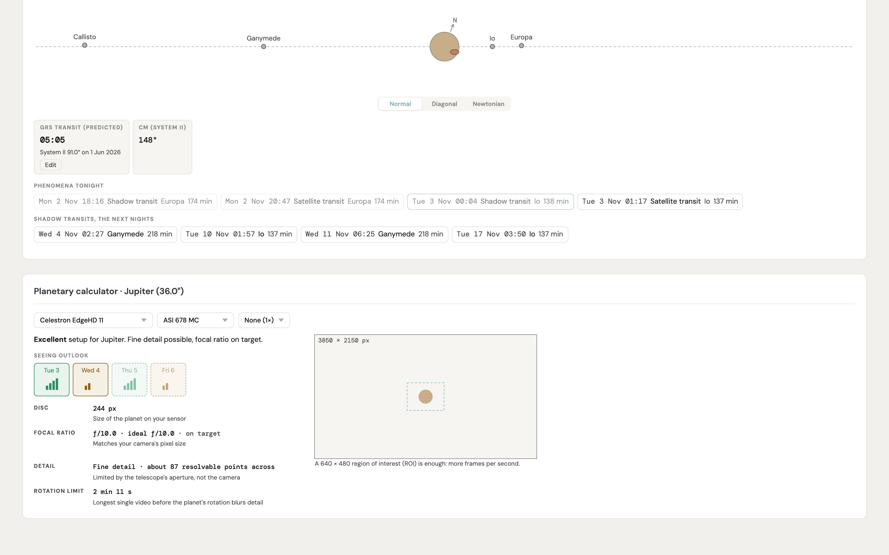
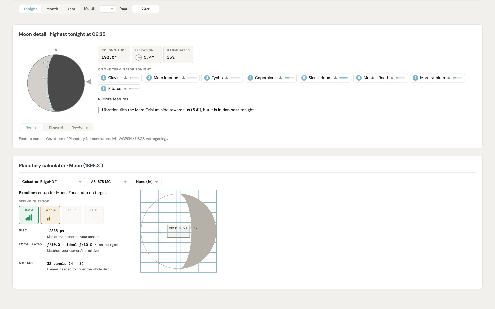
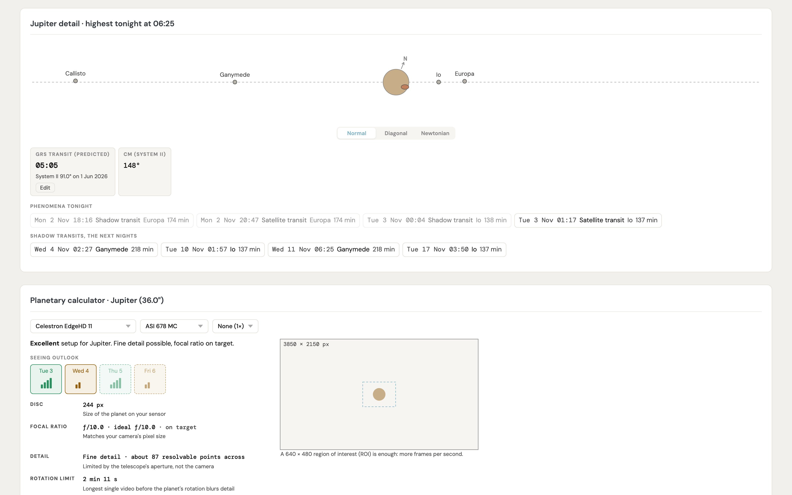
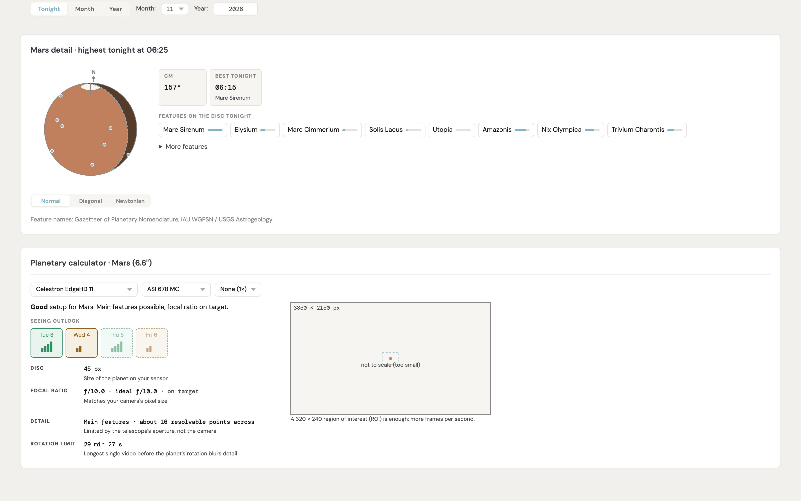
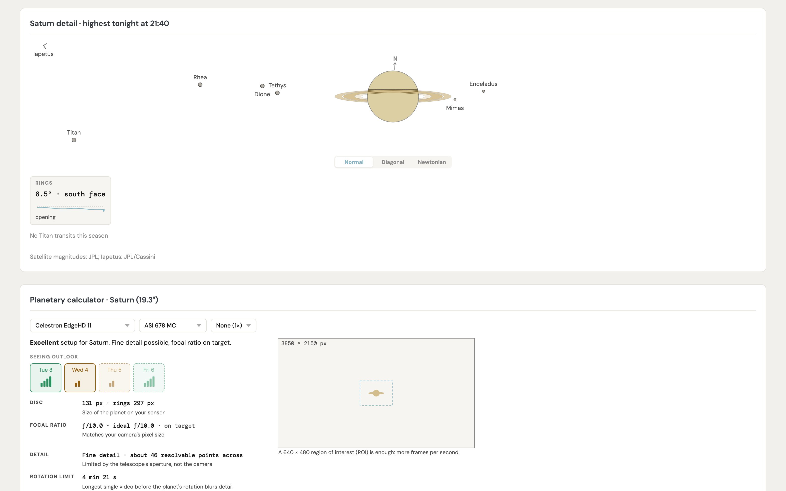

### Multi-Language Support

Nova is available in 6 languages. Use the language selector in the header to switch at any time — your preference is saved per user account.

| Language | Status                                       |
|---|----------------------------------------------|
| English | Original                                     |
| German | Machine-translated, community review welcome   |
| French | Machine-translated, community review welcome |
| Spanish | Machine-translated, community review welcome |
| Japanese | Machine-translated, community review welcome |
| Chinese Simplified | Machine-translated, community review welcome |


### Mobile Companion

Nova includes a mobile-first interface for essential planning on the go. Access it at `/m/up_now` on your instance.

* **Up Now:** Responsive list of currently visible objects with slider-based altitude/size/magnitude filters, sort dropdown, and tap-to-navigate opportunity cards.
* **Outlook:** Upcoming imaging opportunities grouped by date with click-to-navigate to the altitude chart.
* **Object Detail:** Full target info, altitude charts, moon separation, and framing assistant.
* **Journal:** Create new session entries from your phone with rig and filter selection.
* **Quick Add:** Add new objects to your database directly from your mobile device.


### Sorting, Filtering, and Saved Views

* **Sorting:** Click column headers to sort. A second click reverses the order.
* **Filtering:** Each column has a search box. You can use operators like `>` (greater than), `<` (less than), or `!` (exclude).
    * *Example:* Type `>45` in the Altitude column to see only objects currently high in the sky.
    * *Example:* Type `Galaxy` in the Type column.
* **Saved Views:** Save a specific combination of filters and sort orders.
    1. Set up your filters (e.g., "Nebulae", "Altitude > 30").
    2. Click the **"Views"** dropdown.
    3. Save the view (e.g., "Good Nebulae").
    4. **Sharing:** You can mark a view as "Shared" to let other users on your server use it.

### Visual Discovery: The Inspiration Tab (Night Explorer)

The Inspiration Tab offers a visual way to browse potential targets. Instead of a data table, this view presents tiles for objects that are currently observable.

* **Smart Sorting:** The grid follows the dashboard's current sort order (altitude by default, or Nova Rank when Ask Nova is active).
* **Pagination:** Tiles are displayed 20 per page with prev/next controls; clearing the dashboard filters or changing the view resets to the first page.
* **Imagery:** Tiles display survey images (DSS2) by default. If you have uploaded your own astrophoto for an object, it will be displayed here.
* **Quick Info:** Each tile displays the object's type, current altitude, and constellation. Clicking a tile opens a detail modal with a summary and a link to the full charts.


### Your Results: The Gallery Tab

The Gallery tab on the dashboard is a showcase of your own astrophotos — every photo you have attached to a journal session or a project.

* **Project and Session Tiles:** Project tiles show the target, the rig(s) used, the project name and its total integration time. Session tiles show the filter, integration time and date.
* **Newest First:** Projects and sessions are merged into one grid, sorted by date.
* **Click Through:** Click a tile to open that project or session in the journal.
* **Thumbnails:** Nova creates a small thumbnail for every uploaded image, so the grid loads quickly. Images uploaded before thumbnails existed get one automatically the first time the Gallery shows them.

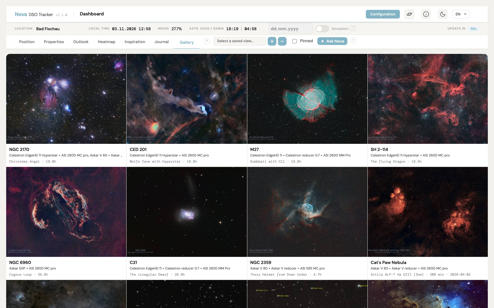

### Long-Term Planning: The Yearly Heatmap

The Yearly Heatmap visualizes target visibility over the next 12 months.

* **Waterfall Visualization:** Darker green indicates higher quality imaging time. Vertical white bands highlight full moon periods.
* **Data Loading:** Data is loaded in chunks and stored for 24 hours for performance.
* **Integrated Filtering:** Apply your Saved Views directly to the heatmap to narrow down targets.
* **Pinned Only:** A checkbox filters the view to show only your currently pinned objects.


### Projects & Imaging Journal

The Journal is a full **Project Management System**.

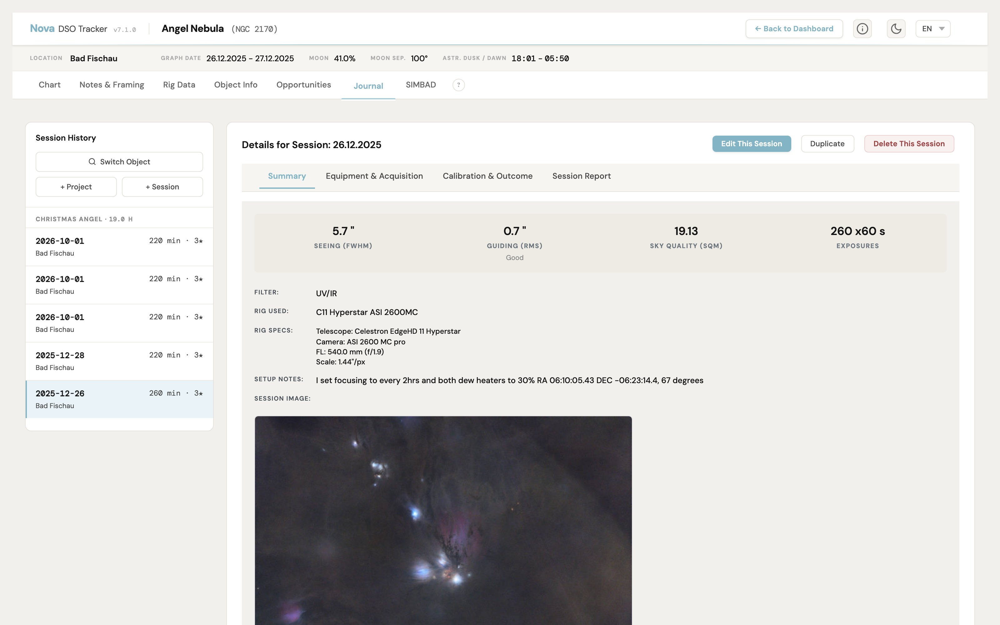

1. **Projects:** A Project groups multiple imaging sessions toward a single goal (e.g., "Mosaic of M31" or "HaOIII data for Helix").

    * **Dedicated Project Pages:** Each project has its own detail page with aggregated stats and rich text notes for goals, framing, and processing.
    * **Status:** Track if a project is `In Planning`, `In Progress`, `On Hold`, `Completed`, or `Abandoned`.
    * **Integration:** Nova automatically sums the exposure time from all linked sessions.


2. **Planning Mode ("New Project"):** Create a project before you have data to plan targets ahead of time. Projects without sessions still appear in the Journal table and the object switcher.


3. **Rig Snapshots:** When you add a session, Nova records a snapshot of your rig's metrics. If you change your telescope configuration later, the history of old sessions remains accurate. Rigs you no longer use can be marked **inactive**: they stay in your list and in old sessions, but are no longer offered for new ones.

    * **Session Form:** Sessions are edited in four tabs — Overview, Equipment & Acquisition, Calibration & Outcome, and Logs & Files — with Save, Save Draft and Cancel always in view.
    * **Guiding Quality Rating:** Your guiding RMS is rated Excellent, Good, Acceptable, Borderline or Unusable based on the image scale of the rig you used. The rating appears in the session summary and report, and the Logs > Guiding tab charts your RMS against these limits.

4. **Guide Optics & Dither Recommendations:** Configure guiding equipment (OAG or guide scope + guide camera) per rig. When set up, dither recommendations appear on rig cards and in the journal form, showing suggested dither pixel values based on your guide camera pixel scale. A rig info modal (⓪ button in the journal form) shows full computed specs including FL, f-ratio, image scale, FOV, and dither guidance.


5. **Custom Mono Filters:** Define custom mono filters for filter wheels or manual changes. Track exposure data per session with full YAML export/import support.

6. **Object Switcher:** Navigate between observed DSO objects directly from the journal sidebar without returning to the dashboard.

7. **Reports:** Generate PDF reports for a specific night (Session Report) or a full target summary (Project Report).

8. **Log File Import & Analysis:** Upload and analyze log files from ASIAIR, PHD2, and N.I.N.A.

    * **ASIAIR Logs:** Capture counts, exposure times, filter usage, and dithering data.
    * **PHD2 Logs:** Guiding RMS, corrections, and drift analysis.
    * **N.I.N.A. Logs:** Full session swimlane (equipment startup, guiding, imaging, platesolving, flats), autofocus analysis with V-curve plots, and error tracking.


9. **Multi-Project Sessions:** A session can be linked to several projects at once via the "Link to Project" checkboxes in the session form (creating a new project inline still works). In the journal sidebar, sessions appear under every linked project in collapsible groups — the group containing your most recent session is expanded by default.

10. **Session Status Column:** The journal's session table has a sortable and filterable Status column showing the status of each session's linked project.

### Detailed Object Information

Clicking a DSO in the main list opens the Detailed View.

* **Altitude Graphs:** Shows the object's path for the current night, with day, month and year views.
* **Weather:** The day chart shows cloud cover and seeing as icons along the top; hover a block for details.
* **Location Selector:** Switch the observing location directly from the status strip.
* **Moon Separation:** Displays angular separation from the moon on the main graph.
* **Rig Data Tab:** Shows how the object fits each of your active rigs.
* **Object Info Tab:** Shows the inspiration content you added for the target — custom image, credit, and description (added via Manage Objects).
* **Imaging Opportunities:** Click "Find Imaging Opportunities" to calculate the best dates based on your horizon and moon constraints.
* **AI Observation Notes:** Generate contextual notes about the target directly from the graph view.

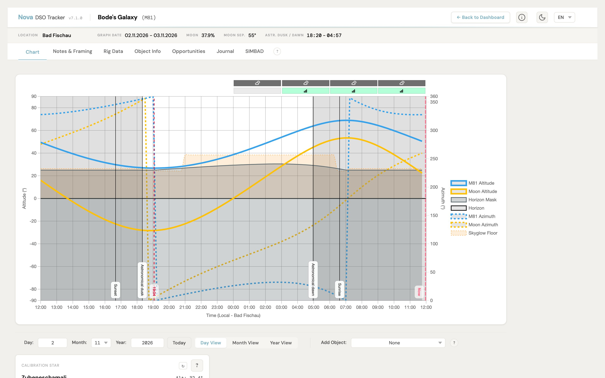

### Framing Assistant

The Framing Assistant integrates Aladin Lite for visual framing and mosaic planning.

1. **Search:** Enter an object name to center the view.
2. **Camera Overlay:** Select your rig to overlay the exact sensor footprint.
3. **Rotation:** Adjust the camera rotation angle.

**Exporting Plans:** Use the **"Copy Plan (CSV)"** button to export plans compatible with ASIAIR (Plan → Import) and N.I.N.A. (Sequencer).


### Configuration and Object Management

The Configuration page manages your library of objects, locations, and equipment.

* **Locations:** Manage observing sites and define **Horizon Masks** (upload a CSV/YAML list of Azimuth/Altitude points to block out terrain).
* **Objects:**
    * **Smart Add:** Nova checks your local database for duplicates before querying SIMBAD.
    * **Import Catalog:** Download curated lists (Messier, Caldwell, etc.) directly from the Nova server.
    * **Range Filters:** Filter by Magnitude and Size using expressions like `>5 <30` or `<15`.
* **Rigs:** Define your optical trains. Accurate data here is required for the Framing Assistant, Rig Snapshots, and dither recommendations.
* **Theme:** Choose Light, Dark, or Follow System. Your choice persists across sessions.


**Manage Objects:**

* **Filtering:** Filter by ID, Name, Type, or Source. Use range expressions for Magnitude (`>5 <30`) and Size. The Status filter includes a **Pinned** option to show only the objects in your pinned project.
* **Bulk Actions:** Enable or disable multiple objects at once. Disabled objects remain in your database but are excluded from calculations and the dashboard.
* **Inspiration Content:** Upload a custom image URL, credit, and description for any object.


**Duplicate Manager:** Scan your library for objects within 2.5 arcminutes of each other. Choose which entry to keep — Nova automatically migrates all journal entries and projects before deleting the duplicate. If two entries are genuinely different objects, choose **Ignore, keep both** and the pair won't be reported again.


---

# Nova DSO Tracker — Setup Guide

The easiest way to install Nova DSO Tracker is via Docker.

[](https://youtu.be/CF__VZEtH_I)

### Docker Image

A pre-built Docker image is available on Docker Hub:

[](https://hub.docker.com/r/mrantonsg/nova-dso-tracker)

**[View on Docker Hub: mrantonsg/nova-dso-tracker](https://hub.docker.com/r/mrantonsg/nova-dso-tracker)**

### Docker Compose (Recommended)

```bash
docker compose up -d
```

This uses the official published image. For local development from source, use:

```bash
docker compose -f docker-compose-dev.yml up -d
```

### Manual Docker Installation

1. **Pull the image:**
```bash
docker pull mrantonsg/nova-dso-tracker
```

2. **Run the container:**
```bash
docker run -d \
  -p 5001:5001 \
  -v nova_data:/app/instance \
  --name nova \
  mrantonsg/nova-dso-tracker
```

### Manual Python Installation

Nova requires Python 3.13 (the version used by the Docker image).

1. **Clone the repository:**
```bash
git clone https://github.com/mrantonSG/nova_DSO_tracker.git
cd nova_DSO_tracker
```

2. **Create a virtual environment:**
```bash
python3 -m venv venv
source venv/bin/activate
```

3. **Install dependencies:**
```bash
pip install -r requirements.txt
```

4. **Run the application:**
```bash
python nova.py
```

Access the application at `http://localhost:5001`.

---

### AI Configuration (Optional)

Ask Nova is disabled by default. To enable it, add the following to your `instance/.env`:

```bash
# AI provider: anthropic, openai, openai-compatible, or ollama
AI_PROVIDER=anthropic

# API key for your provider (leave empty to keep AI disabled)
AI_API_KEY=sk-ant-...

# Model name (must match your provider)
#   Anthropic: claude-sonnet-4-20250514, claude-haiku-4-5-20251001
#   OpenAI:    gpt-4o, gpt-4o-mini
#   Ollama:    llama3, mistral, qwen2.5
AI_MODEL=claude-sonnet-4-20250514

# Base URL — required for openai-compatible and ollama, ignored otherwise
#   Ollama (local):  http://localhost:11434
#   MiniMax:         https://api.minimax.io/v1
AI_BASE_URL=

# Who can use AI features: 'all', or comma-separated usernames
AI_ALLOWED_USERS=all
```

**Provider notes:**
- **Anthropic** — good ranking quality, no base URL needed.
- **OpenAI** — works out of the box, no base URL needed.
- **OpenAI-compatible** — for Z.AI, MiniMax, or any custom endpoint. Requires `AI_BASE_URL`.
- **Ollama** — free, runs locally. Requires `AI_BASE_URL` (default `http://localhost:11434`). No API key needed.

In multi-user mode, set `AI_ALLOWED_USERS` to specific usernames to restrict access. Leave `AI_API_KEY` or `AI_ALLOWED_USERS` empty to hide all AI UI completely.

### User Modes

Nova supports two modes, configured in `instance/.env`:

* **Single-user mode (Default):** No login required. The app assumes one user and bypasses authentication.
* **Multi-user mode:** Ideal for hosting on a shared or public server. Requires login.
    * To enable, set `SINGLE_USER_MODE=False` in your `.env` file.
    * On the first start, Nova creates the admin account (`USER_ADMIN_USERNAME`, default `admin`). Set `USER_ADMIN_PASSWORD` in `.env` to choose its password; otherwise a random password is generated and printed once to the server log.
    * Visitors who are not logged in are sent to the login page. Guest mode is available at `/guest`.

### User Management (Multi-User Mode)

**Web Admin Panel:**

When logged in as `admin`, a **Users** link appears in the header. The admin panel at `/admin/users` allows you to:

* Create new user accounts
* **Deactivate** a user to pause the account: they can no longer log in, but all of their data is kept, and **Activate** restores access
* Reset passwords
* **Delete** a user to remove them permanently: the login **and all of their data** (objects, projects, journal sessions, photos and log files) are deleted and cannot be recovered

Admin accounts cannot be deactivated or deleted.


**CLI Commands:**

All commands are interactive and prompt for input. They are only available in multi-user mode. Run them from the Nova folder and pass `--app nova` so Flask can find the application:

```bash
# Manual installation (with the virtual environment activated)
flask --app nova add-user

# Docker Compose
docker compose exec nova flask --app nova add-user

# Plain Docker (container named nova)
docker exec -it nova flask --app nova add-user
```

| Command | Description |
|---|---|
| `flask --app nova init-db` | Create the user tables if missing (not needed on a new install — Nova creates tables and the admin on first start) |
| `flask --app nova add-user` | Create a new user account |
| `flask --app nova rename-user` | Rename an existing user |
| `flask --app nova change-password` | Change a user's password |
| `flask --app nova delete-user` | Delete a user account and all of their data |
| `flask --app nova purge-orphaned-users` | Remove leftover data of users whose login was deleted by an older version |

---

### License

Nova DSO Tracker is licensed under the Apache 2.0 License **with the Commons Clause**.
Free for personal, educational, and non-commercial use only. Commercial use requires explicit written permission from the author.
